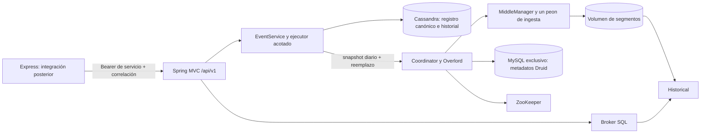

# GreenAlert Events: Java, Cassandra y Druid

Servicio interno independiente, Java 17 + Spring Boot 3.5.8. No sustituye Express ni su autoridad sobre reportes/usuarios; solo acepta eventos ambientales inmutables, consulta historial y publica indicadores derivados. Toda esta entrega está bajo `apps/events`; no requiere cambios en frontend, backend principal, lockfiles npm ni Compose global. Estado de pruebas, recursos y limitaciones observadas: [evidencia](evidence/validacion.md).

## Arquitectura y límites

Estructura modular MVC pequeña: `api` controla HTTP, validación y autenticación; `application/EventService` coordina concurrencia/reconciliación; `domain` define evento/puerto; `adapter` implementa CQL y HTTP Druid; `config` ensambla Spring. No se añade un contenedor de inyección propio ni un bus. El adaptador Druid se usa directamente desde la aplicación: no se declara hexagonal este servicio secundario.

Figura 1. Componentes del servicio. Fuente: elaboración propia.



Una réplica de Events, un nodo Cassandra RF=1 y un Historical son límites de demostración, sin alta disponibilidad. El lock de lectura/escritura de Spring protege la instantánea respecto de escrituras dentro de esa única réplica. **No escalar Events a varias réplicas** sin coordinación distribuida de reconciliación y snapshot. El lock Druid protege publicación de segmentos, pero no sustituye coordinación de snapshots de productores.

## Inicio y variables

Requisitos: Docker Engine/Compose v2, conexión inicial a Docker Hub/Maven Central y presupuesto de memoria indicado en evidencia. Para compilar fuera de Docker: JDK 17 y Maven >=3.6.3. Python >=3.10, solo biblioteca estándar, ejecuta la suite real. No se usan MySQL80, `.env` del principal ni motores externos.

Desde `apps/events`, copiar `.env.example` a `.env` y rellenar cuatro secretos aleatorios distintos. No versionar `.env` ni mostrar `docker compose config` completo: usar `config --quiet`. Las dos claves de API deben tener 32+ caracteres y ser diferentes. Druid usa MySQL con base y usuario `druid_events` en su propio contenedor, nunca la base transaccional. No hay Kafka, PostgreSQL ni conexión a MySQL de Express. `compose.datos.yml` contiene motores/coordinación y `compose.apps.yml` la API; se combinan para resolver dependencias y usan una red externa nueva, `EVENTS_NETWORK=greenalert-events-net`. No reutilizar una red ajena. El arranque respeta salud de datos y terminación del inicializador CQL antes de iniciar Java. Esta separación local no edita los Compose globales de los otros frentes.

```powershell
docker network create greenalert-events-net
docker compose --env-file .env -p greenalert-events -f compose.datos.yml -f compose.apps.yml config --quiet
docker compose --env-file .env -p greenalert-events -f compose.datos.yml -f compose.apps.yml up -d --build
docker compose --env-file .env -p greenalert-events -f compose.datos.yml -f compose.apps.yml ps
```

Por defecto solo se publica `127.0.0.1:18080`. No se publican CQL, SQL, ZooKeeper ni HTTP Druid. `/actuator/health/liveness` es público sin detalles; readiness autentica y consulta Cassandra y SQL Druid. El proceso puede servir historial con Druid caído, aunque readiness devuelva 503. Si Cassandra está ausente al arrancar, Spring falla: reiniciar Events cuando vuelva Cassandra. Las reconexiones tras una caída posterior son del driver.

| Variable | Finalidad / valor por defecto |
| --- | --- |
| `EVENTS_SERVICE_TOKEN` | Bearer exclusivo de Express; obligatorio, >=32 caracteres |
| `EVENTS_RECONCILE_TOKEN` | Bearer exclusivo del operador de proyección; obligatorio, distinto |
| `DRUID_METADATA_PASSWORD`, `DRUID_METADATA_ROOT_PASSWORD` | Credenciales nuevas exclusivas de metadatos Druid en Compose |
| `EVENTS_NETWORK` | Nombre de red externa nueva, creada antes de Compose |
| `EVENTS_PORT`, `PORT` | Puerto host 18080 / escucha Java 8080 |
| `CASSANDRA_HOST`, `CASSANDRA_PORT` | localhost:9042 fuera de Docker, cassandra:9042 en Compose |
| `CASSANDRA_DATACENTER`, `CASSANDRA_KEYSPACE` | datacenter1 / greenalert_events; esquema suministrado usa esos valores |
| `CASSANDRA_USER`, `CASSANDRA_PASSWORD` | Opcionales para despliegue Cassandra autenticado; el sandbox privado no usa autenticación CQL |
| `DRUID_QUERY_URL`, `DRUID_TASK_URL` | Broker y Coordinator/Overlord, separados; localhost:8082/8081 fuera de Docker |
| `EVENTS_WORKERS`, `EVENTS_QUEUE_CAPACITY` | 4 hilos (1..16), 128 en cola (1..512) |
| `DRUID_TASK_TIMEOUT_SECONDS` | 180 (10..600); espera de task, no cancelación remota garantizada |

Para ejecutar solo Java contra motores ya configurados explícitamente: `mvn.cmd test` y `mvn.cmd spring-boot:run`. Esto no inicializa automáticamente un keyspace arbitrario. `infra/schema.cql` solo crea tablas, no elimina ni migra otras bases.

## Contratos internos

OpenAPI generado en `/v3/api-docs`, interfaz `/docs` (ambos protegidos). La copia exportada en `evidence/openapi.json` corresponde a la API comprobada. En navegador, acceder mediante un proxy interno que añada Bearer; no se introduce token en URLs ni se sirve documentación pública. `X-Correlation-ID` es opcional (ASCII `[a-zA-Z0-9_.-]`, 1..64), se devuelve en todas las respuestas autenticadas; si falta se genera UUID. La correlación de entrega no forma parte del contenido inmutable del evento.

| Método / endpoint | Credencial | Resultado |
| --- | --- | --- |
| `POST /api/v1/events` | Servicio | 201 nuevo, 200 mismo evento reparado/reintentado, 409 contenido distinto bajo el mismo ID |
| `POST /api/v1/events/batches?mode=concurrent` | Servicio | 200 receipts, máximo 64 eventos; `mode=sequential` permite medir el mismo trabajo |
| `GET /api/v1/reports/{reportId}/events?from=...&to=...&limit=100` | Servicio | Historial ascendente, rangos UTC semiabiertos, máximo 366 días y 500 resultados |
| `POST /api/v1/reconciliation/{YYYY-MM-DD}` | Operador | Espera task Druid y devuelve taskId, estado, intervalo y cantidad fuente |
| `GET /api/v1/indicators?from=...&to=...&category=agua&severity=3&zone=zona-1` | Servicio | Agregados horarios filtrados; filtros opcionales, rango obligatorio con límites de hora UTC |
| `GET /actuator/health/readiness`, `/actuator/metrics/...` | Servicio | Disponibilidad y métricas internas |

```json
{
  "eventId": "d0000000-0000-4000-8000-000000000001",
  "reportId": "a0000000-0000-4000-8000-000000000001",
  "schemaVersion": 1,
  "type": "REPORT_CREATED",
  "occurredAt": "2026-01-15T12:00:00.000Z",
  "sourceRevision": 0,
  "category": "agua",
  "severity": 3,
  "zone": "zona-1"
}
```

Respuesta habitual `{status:"success",message,data}`; error `{status:"error",message,correlationId}` (el filtro de seguridad omite correlationId en el body y conserva header si es válido). No se exponen mensajes del driver. Códigos: 400 contrato inválido, 401 credencial ausente/incorrecta o de otro propósito, 409 colisión de ID, 413 >256 KiB incluso chunked, 429 capacidad/reconciliación ocupada (`Retry-After:5`), 503 dependencia/timeout. En lotes 429/503/409 pueden ocurrir después de efectos parciales: repetir el lote con los mismos IDs, sin suponer rollback.

El servicio confía exclusivamente en Express como identidad técnica global. No acepta tokens de usuario ni roles enviados en el body. Express debe comprobar propiedad, rol y ámbito **antes** de pedir historial o indicadores; Events no conoce usuarios y no verifica la existencia de un UUID en MySQL. No entregar la clave a web/móvil. El token de operador no permite registrar/consultar eventos. Rotar claves mediante secreto de despliegue y recrear Events; la suite prueba invalidez de la clave anterior. Para salida de la red local se requiere TLS/mTLS o proxy HTTPS y una política de secretos; este sandbox no acredita TLS ni introspección de usuarios del principal.

## Diccionario y Cassandra

| Campo | Tipo / regla | Semántica |
| --- | --- | --- |
| eventId | UUID obligatorio | ID estable de una ocurrencia; globalmente inmutable |
| reportId | UUID obligatorio | Referencia compartida al reporte, no FK entre motores |
| schemaVersion | entero, exactamente 1 | Contrato de contenido; sin coerción de versiones |
| type | enum obligatorio | REPORT_CREATED, REPORT_STATUS_CHANGED, ENVIRONMENTAL_OBSERVATION |
| occurredAt | Instant UTC, precisión <= milisegundo | Tiempo del hecho; entre 2000-01-01 y ahora+5 min |
| sourceRevision | long >=0 | Revisión de origen informativa; no es orden global ni control CAS de MySQL |
| category / zone | código opcional, 1..64 caracteres alfanuméricos, `_` o `-` | Códigos de catálogo/agrupación, sin dirección ni descripción personal |
| severity | entero opcional, 0..5 | Severidad ambiental del hecho |

Se rechazan propiedades desconocidas, revisiones fraccionarias y números enviados como strings; no se truncan ni se convierten silenciosamente. No hay nombre de usuario, correo, coordenada precisa, texto libre, evidencia, contraseña ni token en el evento. Los códigos deben proceder de catálogos; la forma del código no puede detectar PII encubierta por un productor confiable.

Las tres tablas contienen un payload JSON versionado con estos campos, además de las claves tipadas para consulta:

* `events_by_id`: PK `event_id uuid`; `payload text`. Un `INSERT IF NOT EXISTS` (LWT LOCAL_SERIAL) adjudica contenido al UUID. Lectura LOCAL_QUORUM compara todos los campos en reintentos; cambiar fecha o reporte también da conflicto.
* `events_by_report`: partición `(report_id uuid, month text YYYY-MM)`, clustering `(occurred_at timestamp ASC, event_id uuid ASC)`. Lectura por reporte y meses del rango, sin `ALLOW FILTERING`, joins ni índices secundarios. Los límites temporales de historial se enlazan a CQL con precisión de milisegundos; una precisión superior se trunca, por lo que los clientes deben enviar límites en milisegundos (por ejemplo `Date.toISOString()`). `limit` trunca resultados; no se afirma paginación completa para empates de fecha. Para consumo completo mayor a 500 se deberá añadir cursor compuesto; no usar esta lectura truncada para reconstrucción analítica.
* `events_by_day`: partición `(day date UTC, shard int 0..15)`, clustering `(occurred_at,event_id)` ascendente. Hash UUID fijo distribuye carga diaria; 16 consultas con límite de seguridad recuperan hasta 10.000 eventos/día para snapshot analítico. Un día mayor se rechaza explícitamente sin publicar una proyección parcial.

Registro canónico y proyecciones no son una transacción conjunta. Tras LWT, un pequeño logged batch escribe las dos proyecciones; no se usa un batch masivo para todo el lote. Un fallo entre pasos requiere reenvío del productor con el ID original; no hay ACK antes de completar ambos. Aun si la inserción canónica ya existe, el reintento reescribe las proyecciones. No hay TTL que permita reutilizar IDs antiguos, ni borrado de eventos por API. Dimensionar particiones/retención para la tasa real antes de producción; 10.000/día es un límite funcional del snapshot de esta versión, no una capacidad publicada de Cassandra.

## Druid y reconciliación

Datasource fijo `greenalert_events_v1`; ingesta nativa JSON `index` con fuente inline proveniente de Cassandra, sin endpoint que acepte SQL o specs arbitrarios. `timestamp` procede de occurredAt; dimensiones `type,category,severity,zone` (severidad como dimensión string); métricas `events=count`, `reportsCreated=longSum(created)` con created=1 solo en REPORT_CREATED. Segmentos DAY, rollup HOUR. Los límites de consulta de indicadores deben coincidir con horas UTC completas; un rango subhorario se rechaza con 400 porque el rollup ya perdió esa precisión. Son **eventos** y **hechos de creación**, no cantidad de reportes activos, severidad vigente ni usuarios distintos. El productor es responsable de no generar dos UUID diferentes para el mismo hecho de creación.

Reconciliar lee **todo el día**, deduplicado por las claves Cassandra, y reemplaza el intervalo `[día,día+1)` con `appendToExisting=false`, `dropExisting=true`, locks de time chunk. No se añade únicamente el lote reintentado: eso perdería hechos de otros lotes o los duplicaría. La segunda ingesta del mismo snapshot conserva sumas. Un día vacío devuelve EMPTY sin crear tarea; al no haber API de borrado de fuente no elimina un día previamente publicado. Una restauración de fuente parcial exige un procedimiento explícito de reconstrucción, no usar EMPTY como borrado.

Se espera task SUCCESS y disponibilidad de segmentos hasta 60 s; la suite también espera que SQL exponga los agregados exactos. Al exceder el timeout, el task puede seguir en Druid. Consultar sus tareas con el operador y resolver su estado antes de repetir el mismo intervalo. El error HTTP es saneado; si la tarea ya fue identificada, incluye `taskId` y `projectionState=FAILED|UNKNOWN` para que el operador verifique su estado antes de repetir. Una caída después de publicar no requiere deshacer historial: repetir el intervalo completo. Eventos tardíos se reflejan tras reconciliar su día de occurredAt. No hay proyección automática programada ni garantía de frescura hasta ejecutar reconciliación; el llamador debe mostrar esa consistencia eventual.

## Concurrencia, errores y cierre

El lote reparte E/S CQL en `ThreadPoolTaskExecutor`: 4 workers fijos, cola 128, rechazo abort/429. Un lote tiene hasta 64 tareas y espera un presupuesto total de 30 s. Driver CQL limita cada solicitud a 5 s, conexión a 5 s; cliente HTTP Druid conecta en 2 s y cada solicitud termina en 8 s. Se cancelan futures pendientes al error/timeout/interrupción; eso **no revierte una petición que Cassandra ya recibió**. El pool es administrado por Spring y espera hasta 25 s al apagar; servidor graceful 30 s, Compose concede 40 s.

Tomcat limita las solicitudes a 32 hilos. Las altas HTTP individuales se ejecutan en esos hilos; el pool de 4 se usa para tareas de lote. El pico `events.processing.peak` cuenta operaciones globales, incluidas solicitudes individuales simultáneas, y no representa el tamaño del pool.

Un semáforo admite una sola reconciliación. Su lock exclusivo espera escrituras hasta 10 s; mientras se ingiere devuelve 429 a registros nuevos, para no publicar snapshots incompletos. Es una restricción deliberada y visible para este servicio pequeño. Las lecturas no toman ese lock. Métricas: `events.processing.active`, `events.processing.peak`, `events.persistence`, `events.accepted{result=created|replayed}` y métricas estándar del ejecutor. El benchmark usa trabajo CQL real, cuatro muestras por modo, primera como calentamiento, alterna el orden y valida los mismos conteos por reporte. No exige una aceleración artificial.

## Integración posterior con Express

No se modificó Express ni se declara probado un recorrido web→Express→Events. La referencia de cliente [examples/express-events-client.mjs](examples/express-events-client.mjs) implementa timeout, correlación y reintentos HTTP; no está instalada en Express. El adaptador futuro debe:

Mapeo que deberá mantener el adaptador del principal (sin modificar su contrato público):

| Origen actual | Evento v1 | Regla de integración |
| --- | --- | --- |
| `reporte.uuid` | `reportId` | Usar UUID del reporte, no `id_reporte` numérico |
| ID durable del hecho/outbox futura | `eventId` | Asignar una vez y persistir antes de intentar HTTP |
| `nivel_severidad` | `severity` | `bajo=1`, `medio=2`, `alto=3`, `critico=4`, igual al rank de zonas existente; desconocido/ausente se envía null, sin inventar un nivel |
| `tipo_contaminacion` / catálogo | `category` | Código estable ASCII validado; si requiere traducción desde un nombre, tabla versionada explícita |
| Zona de catálogo/cuadrícula versionada | `zone` | Código estable opcional, sin copiar dirección ni coordenadas exactas; null si no existe asociación fiable |
| Fecha del hecho confirmado | `occurredAt` | Convertir a UTC con zona de origen conocida; no volver a fechar un reintento |
| Revisión durable del origen | `sourceRevision` | 0 para alta inicial; el productor futuro debe definir la secuencia para cambios, no se supone que esa columna ya exista en MySQL |

El rango numérico 0..5 admite observaciones ambientales externas; para los reportes actuales se usa la correspondencia 1..4 anterior. Esta correspondencia está documentada para la integración posterior y no cambia las severidades string de Express.

1. Generar/conservar UUID de evento por **hecho confirmado**, junto a reportId y sourceRevision. No generar UUID al reintentar HTTP. Mapear códigos de categoría/zona y severidad real; no enviar el reporte completo ni secretos.
2. Autorizar en el principal con la sesión actual y el ámbito del usuario. Usar credencial técnica, correlación por entrega, pool HTTP y timeout de partida de 10 s (lotes 35 s). Reconciliación es tarea operativa con timeout mayor al configurado en Events.
3. Reintentar errores de transporte/429/503 con los mismos IDs, máximo 3 intentos por ciclo, backoff exponencial con jitter (por ejemplo 200/400/800 ms y respetar Retry-After). Un 409 requiere investigar contenido, un 400 corregir el productor; no reintentar indefinidamente en la solicitud del usuario.
4. Diseñar entrega durable en origen (outbox MySQL u otro registro revisado) antes de afirmar que no se pierden eventos entre commits de MySQL y HTTP. No hay atomicidad MySQL/Cassandra ni rollback global. La presente entrega **no crea una outbox ni cambia las transacciones existentes**. Un timeout no demuestra ausencia de escritura.
5. Tras confirmar/reintentar eventos, registrar el día pendiente de reconciliar; ejecutar snapshot por día después de resolver entregas pendientes. Registrar último task/intervalo y hora de publicación en la capa operativa. Consultar indicadores con rangos/filtros y distinguir proyección pendiente de ausencia real.
6. Al integrar el Compose global, asignar propietario a los archivos compartidos; incorporar estos servicios de datos y app en los dos Compose globales con red externa y secretos, sin enlazar a la base real para pruebas. Actualizar el inventario de endpoints y OpenAPI global durante esa integración. No exponer motores al cliente.

## Pruebas y operación

```powershell
mvn.cmd test
python tests/real_stack.py
```

La suite real no acepta destinos arbitrarios: genera proyecto `ga-events-test-<aleatorio>`, claves, volúmenes y puerto efímero propios; construye imagen, inserta fixtures deterministas, ingiere/consulta Druid, prueba duplicados/fallos/recuperación, benchmark y reinicio completo. Siempre intenta retirar **solo su proyecto**, incluso ante fallo, y deja `.local/<proyecto>/result.json`, OpenAPI y log saneado. Los resultados relevantes se copian sin secretos a `evidence/`. No se atribuyen pruebas remotas, TLS, alta disponibilidad ni recorridos Express a esta suite.

Operación normal: `stop`/`start` o `down` sin `--volumes` preservan datos. No usar `down -v`, `docker volume prune` ni comandos globales en un entorno compartido. Los volúmenes pertenecen al proyecto elegido: Cassandra, metadatos MySQL, snapshots/log de ZooKeeper, deep storage/log de ingesta y estado local de los procesos. El Dockerfile Java es multietapa y ejecuta como UID/GID 10001; Druid conserva su usuario sin privilegios y añade el Connector/J fijado por SHA-256, requerido por su extensión MySQL.

Backup de demostración en frío: detener **este** proyecto completo, identificar sus volúmenes por labels de Compose y archivar cada uno; conservar también la versión de imágenes/configuración y los cuatro secretos fuera de Git. Restaurar únicamente en volúmenes nuevos de otro proyecto con mismas versiones/propietarios; arrancar motores, después Events, verificar historial e indicadores, y recién entonces habilitar productores. Cassandra permite además snapshots nodetool, pero no equivalen por sí solos a restauración de todo el stack. La suite acredita persistencia al reiniciar; **no acredita restauración desde backup ni disaster recovery**.

## Referencias técnicas

La elección de fuentes inline y reemplazo por intervalos sigue la [ingesta nativa de Apache Druid](https://druid.apache.org/docs/latest/ingestion/native-batch/) y sus [input sources](https://druid.apache.org/docs/latest/ingestion/native-batch-input-sources.html/). El metastore usa la [extensión MySQL oficial](https://druid.apache.org/docs/latest/development/extensions-core/mysql/), que requiere añadir Connector/J. Las consultas y LWT siguen [CQL DML de Cassandra](https://cassandra.apache.org/doc/latest/cassandra/developing/cql/dml.html). La gestión del pool usa [Task Execution de Spring](https://docs.spring.io/spring-framework/reference/integration/scheduling.html). Versiones seleccionadas se comprueban con los motores de la suite, no solo por estas referencias.
