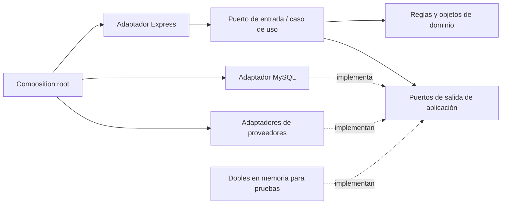

# Arquitectura objetivo: evolución incremental

Ya están implementados [el piloto de zonas de riesgo](piloto-hexagonal-zonas-riesgo.md) y [las cuatro lecturas de reportes](hexagonal-reportes-lectura.md). Este documento conserva la propuesta general para los demás módulos y escrituras; no significa que hayan sido migrados.

**Propuesta, todavía no implementada.** La primera extracción debe funcionar con Express y MySQL existentes. Adoptar NestJS no es requisito de arquitectura hexagonal y añadirlo ahora mezclaría migración de framework con cambio de dependencias.

La dirección de dependencias propuesta es `adaptadores → aplicación → dominio`. Los puertos de salida pertenecen a la aplicación que los necesita. Los adaptadores implementan contratos; los casos de uso reciben implementaciones desde un composition root. Un archivo llamado `repository` que siga importando el modelo SQL global dentro del caso de uso no aplica inversión de dependencias.



La separación permite probar la aplicación sin interfaz ni base de datos, conforme al artículo original de [Ports and Adapters de Alistair Cockburn](https://alistair.cockburn.us/hexagonal-architecture). La estructura concreta de carpetas siguiente es una propuesta para GreenAlert, no una exigencia de ese artículo:

```text
apps/backend/src/
  modules/
    analitica/
      domain/              # agrupación, score y tendencia sin I/O
      application/         # consultar zonas y alertas; contratos de entrada/salida
        ports/
      adapters/
        inbound/http/      # traducción Express de query/respuesta
        outbound/mysql/    # consultas usando pool existente
  bootstrap/               # ensamblaje explícito
  ...                      # módulos actuales coexisten durante migración
```

No crear toda esta estructura vacía ni `packages/domain` antes de extraer un caso real. Mantener JavaScript ESM y contratos documentados con JSDoc inicialmente; TypeScript puede evaluarse por separado.

## Mapa de módulos, casos de uso y puertos propuestos

| Dominio/módulo | Casos de uso | Puertos de salida | Adaptadores existentes que se pueden encapsular |
| --- | --- | --- | --- |
| Identidad | Registrar, autenticar, refrescar/revocar sesión, verificar correo, cambiar contraseña/perfil | UsuarioRepository, SesionRepository, PasswordHasher, TokenSigner, OAuthIdentityProvider, MailSender, Clock, TokenGenerator | usuario/refresh-token.model, crypto/JWT, servicios Google/Facebook/email |
| Reportes | Crear, consultar, editar, moderar, borrar lógicamente y gestionar evidencias | ReporteRepository, CategoriaReader, EvidenceRepository, FileStorage, ImageClassifier, EvidenceScorer, UnitOfWork, EventPublisher | Modelos SQL, Cloudinary, clasificacion/ia/evidencia-score.service |
| Instituciones | Resolver responsables, asignar principal/apoyo, consultar bandeja y actualizar atención | EntidadRepository, AsignacionRepository, AlertaEntidadRepository, NotificationSender | Entidad/ReporteEntidad/AlertaEntidadModel, reglas de asignación y Socket.IO |
| Catálogo | Listar, crear/editar y activar categorías | CategoriaRepository | CategoriaRiesgoModel y fallback actual |
| Administración | Consultar usuarios, cambiar rol/estado y borrar lógicamente | UsuarioRepository, AuthorizationPolicy | admin.controller y modelo de usuario |
| Notificaciones | Registrar, consultar, leer/eliminar y enviar push | NotificacionRepository, DeviceTokenRepository, PushGateway, RealtimeGateway | Modelos, fcm.service y Socket.IO |
| Analítica | Consultar indicadores, tendencias, zonas y alertas cercanas | ReporteAnaliticaReader, Clock, Cache | reporte.model agregaciones, prediccion.service y Map actual |
| Asistente | Responder consulta y construir contexto ambiental | ContextReader, ConversationalProvider, ConversationStore si se justifica, Cache | chatbot-context, Groq/Gemini/offline actuales |

Los puertos de entrada son las operaciones de aplicación, no objetos `req/res`. Un adaptador HTTP valida formato y convierte identidad, query y multipart a DTO simple. La aplicación valida las reglas de negocio y devuelve un resultado independiente de HTTP. El adaptador conserva status y envelope existentes.

## Primera extracción concreta

`ConsultarZonasRiesgo({ dias, tipo, min_score })` recibe `reporteReader`, `clock` y `cache`. El reader expone `findParaPrediccion({desde,tipo})` con objetos simples; la implementación inicial delega al modelo MySQL actual. El reloj reemplaza el uso directo de Date.now en cálculo y expiración; el adaptador de caché conserva TTL de cinco minutos y claves/invalidación actuales. Los valores por defecto, cuadrícula de 0.05 grados, score, dos ventanas temporales y JSON se preservan.

La segunda operación extraíble es `ConsultarAlertasPredictivas`; reutiliza el mismo cálculo, conserva filtros de radio/nivel y las autorizaciones HTTP actuales. No mover todo el controlador de reportes junto con la primera operación.

## Decisiones de consistencia antes de extraer escrituras

Crear un reporte coordina MySQL y Cloudinary con compensación manual, más asignación y alertas que pueden fallar por separado. Definir qué debe ser atómico y qué puede reintentarse. Un UnitOfWork inicial solo debe garantizar transacciones dentro de MySQL; no fingir atomicidad con proveedores remotos. Considerar un outbox transaccional cuando exista una necesidad de entrega durable, con idempotencia, reintentos y observabilidad. No introducir Kafka/RabbitMQ solo por mover carpetas.

Los estados de reporte y atención institucional son conceptos distintos. Las políticas de propiedad/rol/entidad y las transiciones pertenecen al dominio/aplicación. Consultas geográficas, SQL, hashes/SDK, transporte de correo, parsing de archivos y Socket.IO pertenecen a adaptadores. Configuración y secretos se leen una vez al ensamblar, fuera del dominio.

## Criterios de separación real

El caso de uso debe ejecutarse en una prueba con reader/clock/cache en memoria sin importar Express, mysql2, modelos globales, `process.env` o SDK. La misma suite contractual debe pasar con el adaptador SQL. Las pruebas HTTP verifican rutas, roles y respuesta; no se sustituyen por pruebas de nombres de carpetas. Comparar cargas de ejemplo antes/después y conservar algoritmo/contratos antes de plantear una implementación alternativa.
