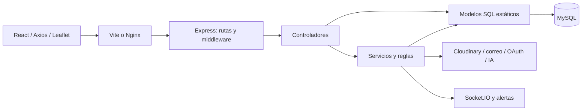

# Auditoría del estado actual

Este documento registra la auditoría inicial. Consultar la [validación posterior de MySQL y Docker](validacion-mysql.md) para las correcciones de catálogo, geometría y migraciones, y las pruebas reales ya ejecutadas.

La [consulta de zonas de riesgo](piloto-hexagonal-zonas-riesgo.md), las [cuatro lecturas de reportes](hexagonal-reportes-lectura.md) y la [creación de reportes](hexagonal-reportes-creacion.md) ya se extrajeron mediante dominio/aplicación/puertos/adaptadores. El diagnóstico por capas que sigue permanece como referencia histórica y describe todavía los demás módulos y escrituras; no se migró el backend completo.

Fecha de revisión: **18 de noviembre de 2026**, America/Bogota. Evidencia: código de las ramas `main` indicadas en [procedencia](procedencia.md), manifests, lockfiles, configuración e inventarios de este monorepositorio. No se inspeccionó una base productiva ni una instalación desplegada.

## Arquitectura comprobada

La API es un **monolito Express por capas**. `src/server.js` carga entorno, valida correo, comprueba MySQL e inicia HTTP/Socket.IO. `src/app.js` configura Helmet, CORS, JSON, formularios, estáticos, ocho routers y manejo de errores. Los controladores combinan validación, autorización, reglas y coordinación; los modelos son objetos estáticos que importan un pool MySQL compartido. Los servicios mezclan algoritmos, SQL indirecto, HTTP y efectos externos. Es una organización similar a MVC para una API, sin vistas de servidor; no hay pruebas de microservicios ni separación hexagonal efectiva.

El frontend es una SPA React con páginas cargadas mediante `lazy`, providers de autenticación/toasts, rutas públicas y protegidas por rol. Axios usa `/api`, interceptores y refresh proactivo/reactivo; las credenciales de sesión se guardan en `localStorage`. Leaflet muestra mapas, clusters y calor; PDF se genera con jsPDF y exportación de backend con ExcelJS/CSV. Las notificaciones visuales usan polling. No hay cliente Socket.IO en las dependencias/frontend actual.

## Módulos y acoplamientos

| Área | Implementación actual | Acoplamiento principal |
| --- | --- | --- |
| Identidad y sesiones | auth.controller, usuario/refresh-token.model, OAuth y correo | Express, crypto, JWT, SQL, Cloudinary y estado en memoria en un mismo flujo |
| Reportes y evidencias | reporte.controller/model, evidencia.model, uploads y score | Validación, autorización, persistencia, IA, archivos y compensación en controlador |
| Catálogo | categoria-riesgo.controller/model | Reglas y fallback dentro del modelo SQL |
| Administración | admin.controller + usuario.model | Políticas de rol y persistencia directa |
| Instituciones | entidad.controller, entidad/reporte-entidad/alerta-entidad.model, asignacion-entidades.service | Reglas institucionales importan modelos, controlador de notificaciones y Socket.IO |
| Notificaciones | notificacion.controller/model, fcm-token.model, fcm.service | Función usada como servicio exportada desde controlador; push incompleto |
| Analítica | prediccion.controller/service, agregaciones en reporte.model | Algoritmo depende de modelo concreto, Date.now y Map global |
| Asistente | chatbot.controller/service/context/offline | Proveedores remotos, consultas, caché y fallback juntos |

## Persistencia y modelos

Solo se encontró **MySQL**, con pool `mysql2/promise`, `execute` parametrizado, metadatos de compatibilidad de esquema y SSL opcional. No hay ORM. El servidor MySQL remoto y su versión efectiva no se conocen. [Dependencias exactas](dependencias.md).

| Tabla del esquema completo | Responsabilidad |
| --- | --- |
| usuarios | UUID, perfil, scrypt, rol, institución opcional, OAuth, verificación/OTP, preferencias y borrado lógico |
| entidades | Organismos activos: bomberos, Corpoamazonia, gestión del riesgo, salud y servicios públicos |
| categorias_riesgo | Códigos, etiquetas, colores, iconos, prioridad y estado |
| reportes | Autor, categoría/subcategoría, severidad/estado, ubicación, IA, moderación, contadores, soft delete |
| reporte_entidades | Relación reporte/institución, asignación principal/apoyo, prioridad, atención y comentario |
| alertas_entidad | Alertas institucionales persistidas, lectura, prioridad y deduplicación por asignación/tipo |
| evidencias | Archivo/URL, proveedor, metadatos Cloudinary, hash y borrado lógico |
| refresh_tokens | Hash de token, expiración, revocación, IP y agente de usuario |
| reporte_likes | Interacciones por usuario/reporte |
| reporte_vistas | Registro de vistas con controles de repetición |
| notificaciones | Mensajes por usuario y estado de lectura |
| fcm_tokens | Dispositivos/tokens push asociados a usuarios |

Hay 18 migraciones SQL numeradas, esquema completo, creación de base y consulta de verificación; no hay runner/versionado automático de migraciones. El esquema incluye semillas y procedimientos. No fue aplicado aquí. Se corrigió la declaración de un índice SPATIAL sobre columna nullable, incompatible con MySQL; se mantiene la ubicación opcional y el índice latitud/longitud. Pendiente diseñar y probar la indexación geográfica con datos reales.

## Autenticación y seguridad observadas

Contraseñas con salt aleatorio y `crypto.scryptSync`; JWT Bearer con roles e identidad de entidad; refresh tokens aleatorios guardados como hash, rotación/revocación y logout global protegido. OTP y tokens de verificación/recuperación usan hashes y expiración. Google/Facebook cuentan con intercambio y estado OAuth; el callback usa código efímero, evitando enviar el JWT por query string. Helmet, CORS configurable, rate limits, validación de identificadores y archivos, permisos por dueño/rol/entidad y borrado lógico tienen pruebas existentes.

Esto no equivale a un pentest. Riesgos a revisar: tokens persistentes en localStorage ante XSS; JWT expirado produce 403 pero Axios refresca reactivamente ante 401; validación de estado del usuario por solicitud; almacenamiento en memoria de estado/código OAuth y cachés al escalar; configuración SSL permite desactivar verificación si no se exige explícitamente; uploads y proveedor externo sin transacción distribuida. No se alteraron estos contratos en esta fase.

## Hallazgos y prioridad

| Prioridad | Hallazgo comprobado | Tratamiento |
| --- | --- | --- |
| Alta | Backend sin lockfile, ignorado por .gitignore, Docker usa npm ci | Lockfile generado y versionable; rangos originales conservados |
| Alta | Prueba frontend leía copia antigua dentro de Backend/Frontend | Apunta exclusivamente al cliente real; añade 12 contratos omitidos y compara rutas Express |
| Alta | Firebase Admin y exifr se importan dinámicamente, pero no existen en dependencies/resolución | Documentado como funcionalidad parcial; decidir incorporación en otra tarea |
| Alta | SQL original crea índice espacial sobre POINT nullable | Corregido solo bootstrap; ejecución real pendiente |
| Alta | Taxonomía de semillas SQL difiere de UI/fallback (`contaminacion_agua` frente a `agua`, `basura` frente a `residuos`, etc.) | No se renombraron datos; acordar taxonomía y migración explícita antes de validar flujo completo |
| Alta | Alta de reporte combina SQL, Cloudinary, IA, compensación y asignación; falla de asignación se registra sin deshacer alta | Preservado; diseñar atomicidad/reintentos y contratos antes de separar |
| Media | EMAIL_FROM de ejemplo incluye nombre, pero el validador solo admite dirección | Corregido ejemplo; JSON transport local explícito |
| Media | API_PREFIX es vacío por defecto; ejemplo y cliente/proxy requieren /api | Configuración local consistente /api; default de código preservado |
| Media | Node 20 en Docker/CI originales está fuera de soporte | Referencia Node 24 en nueva CI/Docker; entorno local validado con Node 26 |
| Media | Healthcheck original ignoraba r.ok y usaba ruta sin considerar prefijo | Comprueba código HTTP y prefijo |
| Media | Frontend Docker healthcheck usaba curl no garantizado en imagen Alpine | Usa wget; Compose histórico también alineado |
| Media | Nginx podía servir imágenes uploads con regla de assets, sin proxy | Prefijos ^~ para uploads/API y proxy Socket.IO explícito |
| Media | Límite por defecto Nginx de 1 MiB no corresponde a uploads de hasta 10 archivos de 10 MiB | Límite del proxy 110 MiB; validación del backend permanece intacta |
| Media | Workflow frontend original publica GitHub Pages; workflows anidados no ejecutan desde monorepo | CI raíz solo valida; workflows originales quedan como referencia |
| Media | Cache npm, dist y repomix versionados en fuentes | Fuera del índice actual, recuperables en historial; fuentes/componentes preservados |
| Media | FCM service worker contiene configuración pública de un proyecto y SDK compat distinto al SDK app | Conservado, sin imprimir valores; alinear proyecto y build antes de activar push |
| Baja | Dependencias heredadas deprecadas y Browserslist antiguo | Registrado; no se ejecutó actualización masiva ni audit fix |
| Baja | README/docs históricos contienen rutas, versiones y enlaces no siempre actuales | README raíz y docs de fase son la entrada vigente; documentos originales conservados |

## Límites de la auditoría

Inventario exhaustivo de registros HTTP, manifests y modelos; revisión dirigida de flujos y pruebas, no demostración formal de cada rama de código. No hay credenciales ni datos productivos. No se ejecutaron SMTP, OAuth externo, Cloudinary, HF/Groq/Gemini, FCM, migraciones o ML. Docker CLI permite validar Compose, pero no hubo motor accesible. No se hizo una auditoría exhaustiva de secretos de cada commit histórico ni una auditoría de vulnerabilidades completa; no se publicaron historiales ni valores privados. [Resultados verificables](verificacion.md).
