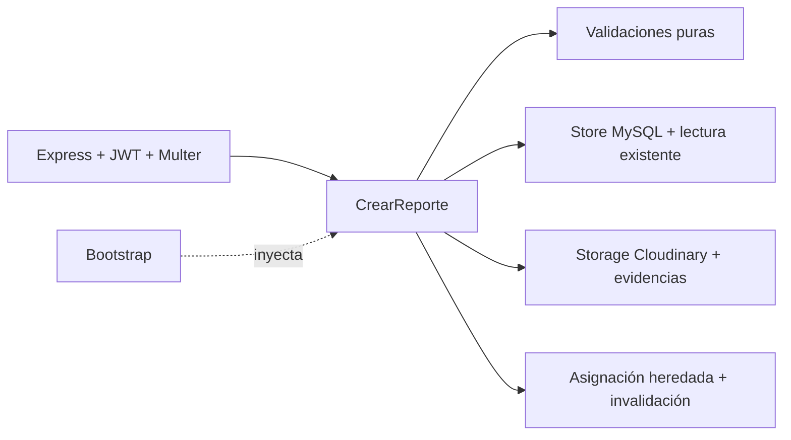

# Creación hexagonal de reportes ambientales

Entrega del **24 de noviembre de 2026**. Se extrajo exclusivamente `POST /reportes` (con el API_PREFIX vigente), a partir de `2a4946b`. El [contrato original](contrato-creacion-reportes.md) se documentó antes de modificar el backend; las capturas previas y la comparación posterior acreditan compatibilidad de respuestas y efectos persistidos. Actualización, eliminación, moderación, asignaciones y gestión independiente de evidencias siguen heredadas.

## Estructura y responsabilidades

```text
apps/backend/src/
  bootstrap/reportes-creacion.js
  modules/reportes-creacion/
    domain/validaciones.js
    application/
      ports.js
      crear-reporte.js
    adapters/
      inbound/express-controller.js
      outbound/
        mysql-reporte-writer.js
        cloudinary-evidence-storage.js
```

Dominio: validaciones puras de campos requeridos, severidad, coordenadas, IA aceptada y cantidad/videos. Estado inicial y severidades siguen reexportados desde el modelo para sus consumidores. No se añadieron entidades sin comportamiento ni dependencias de infraestructura.

Aplicación: `createCrearReporte` recibe puertos estructurales documentados con JSDoc. Coordina catálogo, score, persistencia, IA, evidencias, compensación, asignación e invalidación. No importa Express, MySQL, modelos, controladores, servicios, adaptadores, entorno o reloj global. Devuelve `{reporte}` y errores semánticos; se ejecuta con dobles sin base de datos.

| Puerto/dependencia de aplicación | Adaptación en producción |
| --- | --- |
| ReporteCreationStore: create, findById, updateIaAnalysis, remove | Writer MySQL inyectado + puentes existentes de lectura y borrado lógico |
| categorias.esValido | Modelo de catálogo existente, con su fallback |
| evidencias.create | Modelo existente de evidencias, sin migrar su gestión |
| EvidenceStorage: validateContent, upload, cleanup | Validación de contenido existente y adaptador Cloudinary con funciones inyectadas |
| analisis.score / analizar | Score/hash/EXIF y análisis heurístico existentes; no se incorporó ML |
| efectos.asignar / invalidateCache | Servicio de asignación existente y caché compartida de zonas/alertas |
| logger.error | Console inyectada para errores de compensación/asignación |

Entrada Express: reúne `file`/`files` en el orden original, construye el objeto de entrada, transforma errores de dominio en 400 y conserva 201/envelope/mensaje. Otros errores pasan al manejador actual. Rutas y middleware JWT/Multer no cambiaron.

Writer MySQL: contiene el INSERT original (con/sin punto) y UPDATE IA, con pool y randomUUID inyectados. Los métodos originales del modelo delegan al mismo adaptador, sin duplicar SQL. Conserva SRID 4326, longitud antes de latitud y `axis-order=long-lat`; con una coordenada ausente persiste ambas null como antes.

Storage: conserva payload, metadatos, orden y limpieza con Promise.allSettled. El controlador heredado de evidencias reutiliza este helper compartido mediante bootstrap para evitar dos implementaciones; sus endpoints y su lógica no se migraron.

Bootstrap conoce implementaciones concretas y las inyecta por fábricas, sin contenedor DI. Los pequeños adaptadores de servicios heredados son objetos/funciones explícitos de composición; no se crearon clases delegadas innecesarias. El controlador anterior reexporta el handler de creación.

## Flujo y consistencia



La dependencia apunta de adaptadores hacia aplicación/dominio. La aplicación solo conoce contratos; los modelos y funciones concretos se conectan en bootstrap. El flujo mantiene validación y score antes del INSERT; luego lectura, análisis aceptado/heurístico, UPDATE IA, segunda lectura, uploads e INSERT de evidencias secuenciales. Después intenta asignar y finalmente invalida caché. Responde con el snapshot anterior a asignaciones.

**No existía ni se añadió una transacción global.** INSERT, IA y evidencias mantienen autocommit. Si fallan, se intenta limpiar los uploads conocidos y marcar el reporte con deleted_at, conservando el error original. Un INSERT fallido sin insertId no intenta borrar un reporte. Los escenarios de fallo SQL/upload comprobados no dejan un reporte nuevo activo cuando la compensación SQL responde.

La compensación no equivale a rollback SQL: las evidencias previas pueden permanecer asociadas al reporte borrado y sus URLs referir assets limpiados. La indisponibilidad de Cloudinary puede impedir cleanup; un fallo del borrado lógico puede dejar el reporte activo. Las pruebas unitarias acreditan estos límites heredados y que no se sustituye el error original. No se promete ausencia absoluta de registros/archivos residuales.

Una futura unidad transaccional local podría agrupar reporte, IA y evidencias; necesitaría que todos los accesos usasen la misma conexión y una decisión sobre la visibilidad del borrado lógico y las compensaciones. Mantener una transacción SQL abierta durante subidas HTTP no resolvería atomicidad con Cloudinary. No se introdujeron transacciones, colas, outbox ni políticas de reintento que cambien el contrato existente.

Asignación es best effort: si falla, se registra el error y se conserva la creación/201 e invalidación. El servicio original mantiene asignaciones, notificaciones, alertas y Socket.IO, incluida su posibilidad de progreso parcial. No se migró ese módulo. Las estadísticas siguen leyendo las tablas y no añaden una escritura al alta.

## Caracterización y resultados

Se capturaron **38 escenarios desde las fuentes originales**: autenticación ausente/inválida, cuatro roles válidos, campos y categoría inválidos, coordenadas/POINT, IA aceptada/ignorada, multipart con imágenes/video y límites, errores de INSERT/IA/evidencias, upload inicial/posterior, cleanup y asignación. Se comparan código y JSON completos, orden, filas de cinco tablas, geografía, uploads/limpiezas y caché. Se usan JWT, usuarios y archivos sintéticos; Cloudinary es un cliente simulado explícito y SQL es real.

Fixture: `apps/backend/tests/fixtures/reportes-creacion/contrato.json`, referencia `2a4946b`. Solo se canonizan UUID y el nombre aleatorio de la base temporal en errores. Se fijaron reloj, sesión SQL y zona UTC; la caracterización inicial nativa reveló la diferencia de zona del servidor frente a Docker y se repitió la captura UTC contra las fuentes originales, sin generar expectativas desde el refactor. El fixture de comparación final procede de MySQL Docker 8.4.11.

| Comando desde raíz | Resultado |
| --- | --- |
| npm test | **347**: 324 backend + 23 frontend; cero fallos/omitidas |
| npm run test:reportes:creacion | **38/38** equivalentes a las capturas originales en Express/MySQL Docker |
| npm run test:reportes:lectura | **33/33** equivalentes; fixtures anteriores intactos |
| npm run test:mysql:docker | **57/57**, incluyendo zonas, escrituras y migraciones |
| npm run test:stack | **8/8**, MySQL/Express/React-Nginx con Node 24; creación/listados/detalle/geografía/caché |
| npm run build | Sintaxis backend y bundle React correctos |
| npm run lint | Cero warnings ESLint |
| npm run test:smoke | Correcto, proxy y contratos HTTP sin persistencia |

Las **32 pruebas nuevas** incluyen 27 del caso con puertos simulados y cinco de adaptadores/independencia arquitectónica. Verifican orden de efectos, autor, validaciones, fallos en cada paso, compensación parcial, limpieza best effort y errores HTTP. Se adaptaron cinco archivos de tests previos, conservando sus aserciones y apuntando las inspecciones de SQL/código a la nueva ubicación. No se eliminaron pruebas.

Problemas de verificación resueltos: Docker estaba detenido y se inició desde su instalación de usuario; un fallo DNS inicial al construir el stack se resolvió descargando las imágenes base y repitiendo el runner. Las aserciones estáticas se actualizaron tras el traslado de funciones. Una aserción adicional de coordenadas necesitó tolerancia 1e-10 para los DOUBLE geográficos de MySQL; la comparación completa con el fixture sigue siendo exacta. Se conservaron los warnings existentes de Vite/Vitest/Browserslist sin actualizar dependencias.

No se probaron Cloudinary/SMTP/push/OAuth remotos ni navegación visual interactiva. La integración final de creación se verificó en MySQL 8.4.11 y Node local 26, y en stack Node 24. MySQL nativo 8.0.46 se usó para la caracterización inicial original, no como acreditación del refactor final.

## Reproducción y archivos

Con Docker Desktop iniciado, en PowerShell desde raíz: `npm.cmd run test:reportes:creacion`. El runner crea contenedor, base, credenciales y puerto propios, usa el esquema solo dentro de esa base vacía y retira sus recursos. No usa MySQL80 ni la base del .env. El worker solo sirve pruebas, no está conectado al arranque productivo. Informes locales en `.local/mysql-validation/` (ignorados).

`--capture` exige fuentes iguales a `2a4946b` y fixture inexistente (escritura exclusiva). No regenerar expectativas desde el código nuevo. El modo `--native` permite usar una instancia nativa separada si se dispone de mysqld, conservando el aislamiento.

Archivos de producción: módulo y bootstrap del árbol anterior; `src/controllers/reporte.controller.js` y `src/models/reporte.model.js`. Tests adaptados: `clasificacion-ia`, `reporte-categoria-validacion`, `reporte-estado-inicial`, `reporte-evidencias-subcategoria`, `reporte-upload-evidencias`. Nuevos: `reportes-creacion-caso`, `reportes-creacion-adaptadores`, helper `tests/helpers/reporte-creacion-controller.js`, fixture, `scripts/reportes-create-worker.mjs` y `scripts/validate-reportes-create.mjs`. También comando raíz, CI y documentación. No cambiaron frontend, rutas, middleware, lockfiles, esquema ni migraciones.

Pendientes: transaccionalidad/compensación endurecida como cambio explícito, modelos/servicios heredados, actualización, eliminación, moderación y gestión de evidencias/asignaciones. **La entrega termina en creación; no se inicia ninguna de esas migraciones.**
