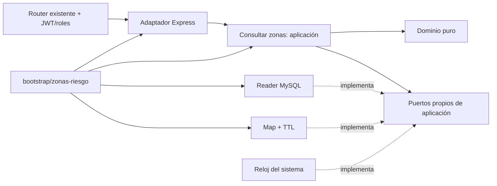

# Piloto hexagonal: consulta de zonas de riesgo

Primera extracción real, limitada a consultar zonas de riesgo. Referencia previa: `a79b6ba`. El [contrato anterior](contrato-zonas-riesgo.md) y ocho respuestas caracterizadas con reloj fijo se capturaron **antes** de cambiar el código. Se conserva JavaScript ESM, Express, MySQL y la interfaz original; no hay cambios de esquema ni dependencias nuevas.

## Estructura implementada

```text
apps/backend/src/
├── modules/zonas-riesgo/
│   ├── domain/
│   │   └── zonas-riesgo.js
│   ├── application/
│   │   ├── consultar-zonas-riesgo.js
│   │   └── ports.js
│   └── adapters/
│       ├── inbound/
│       │   ├── express-controller.js
│       │   └── zonas-params.js
│       └── outbound/
│           ├── mysql-reporte-reader.js
│           └── prediction-cache.js
└── bootstrap/zonas-riesgo.js
```

| Parte | Responsabilidad |
| --- | --- |
| Dominio | Funciones puras de cuadrícula, score, nivel, frecuencia dominante, ventanas y tendencia. Recibe reportes y función de reloj; no realiza I/O |
| Aplicación | Caso `createConsultarZonasRiesgo`: caché, solicitud de dos períodos al lector, cálculo y resultado sin envelope HTTP |
| Puertos | Contratos JSDoc/estructurales de entrada `ConsultarZonasRiesgo` y salida `ReporteAnaliticaReader`, `Clock`, `PredictionCache` |
| Entrada HTTP | Normaliza query y conserva errores 400; llama al caso de uso; responde con el helper HTTP original o entrega el error a next |
| Salida MySQL | Ejecuta el SELECT parametrizado original, con los mismos filtros, campos, orden y tipos de mysql2. Usa el pool inyectado |
| Caché | Implementa el puerto con Map y TTL de 300000 ms; permite limpiar zonas y alertas y consultar tamaño |
| Composición | Único ensamblaje productivo del caso/handler. Inyecta pool existente, reloj del sistema y caché compartida |

No se crearon clases de entidades vacías. Una zona es un agregado de lectura calculado; funciones puras y objetos simples expresan sus reglas sin introducir identidad o ciclo de vida artificiales.

## Flujo y dirección de dependencias



1. El router conserva método/ruta, `verifyToken` y los roles admin/moderador. `prediccion.controller.js` reexporta el handler ensamblado; no se alteró el registro de rutas.
2. El adaptador de entrada convierte dias/tipo/min_score al DTO normalizado y calcula el corte temporal con el reloj recibido.
3. El caso de uso consulta la clave de caché original. Un hit devuelve el mismo payload y timestamp.
4. En un miss, solicita al puerto `findParaPrediccion({desde,tipo})` los dos períodos. El adaptador SQL selecciona solo reportes moderados, no borrados y con coordenadas.
5. El dominio agrupa por celda, compara períodos, calcula score/recencia/severidad y proyecta las zonas sin datos personales.
6. La aplicación añade timestamp/celda y guarda mediante el puerto de caché. El adaptador HTTP conserva el envelope y mensaje originales.

La aplicación **no importa** el modelo ReporteModel, pool global, MySQL, Express, variables de entorno ni adaptadores. Las implementaciones se eligen fuera de ella y se reciben por fábrica. Las pruebas ejecutan exactamente el mismo caso con un reader simulado, reloj fijo y caché en memoria. El adaptador real se prueba también contra MySQL aislado. Esa sustitución y el control de imports son la evidencia de inversión de dependencias, además de la estructura de carpetas.

`ports.js` define contratos estructurales en JSDoc, no clases base o registros de un contenedor. No añade dependencias de runtime ni un framework de inyección. El pool sigue siendo el de `src/config/database.js`; no se abre un pool por consulta.

## Compatibilidad preservada

El cálculo es el original, caracterizado mediante fixtures: celdas de 0.05°, floor con coordenadas negativas, mismos redondeos, score/niveles, dominantes y desempates, corte inclusivo, ventana anterior y orden. Se conservan las coerciones originales de query, incluso parseInt de prefijos numéricos y clamp de días fuera de rango. No se intentó corregir o endurecer el contrato durante esta extracción.

El reader devuelve directamente decimales textuales y Date como mysql2; el dominio y Express mantienen las conversiones y serialización existentes. La consulta usa latitud/longitud, **no POINT ni ST_X/ST_Y**. La escritura geográfica con `axis-order=long-lat` de la fase SQL no cambió. No se ejecutaron migraciones sobre datos existentes.

La caché productiva sigue compartida con alertas. Se conservan namespace, orden de campos de la clave, exclusión de desde, TTL, timestamp cacheado e invalidación por alta/borrado/estado/severidad. El controlador de reportes sigue llamando `invalidatePrediccionCache` a través de su API heredada. Las pruebas reales verifican cambios visibles tras moderar, reducir severidad y borrar, incluyendo resultados de alertas.

Frontend intacto: `getZonasRiesgo` conserva `/reportes/zonas-riesgo` y query; Dashboard sigue leyendo `data.data.zonas` para la capa de ReportsMap. No se reemplazaron componentes, diseño, servicios ni contratos del cliente. Los tests HTTP, el proxy Vite, las pruebas del frontend y el stack Nginx verifican la integración; no se realizó navegación manual exhaustiva de todas las pantallas.

## Puentes y deuda heredada que permanece

- `services/prediccion.service.js` conserva su API exportada. `calcularZonasRiesgo` apunta al caso ensamblado y la invalidación/tamaño usan la misma caché. Las validaciones adicionales, Haversine y proyección de **alertas** permanecen heredadas y reutilizan el piloto; no se creó otro caso de uso hexagonal para ellas.
- `ReporteModel.findParaPrediccion` conserva su firma para consumidores anteriores y delega al mismo adaptador SQL. El SELECT se movió al adaptador; no se mantienen dos copias de esa consulta. El camino HTTP del piloto no pasa por ReporteModel.
- Los otros métodos de ReporteModel y el controlador de reportes siguen por capas. Sus implementaciones antiguas homónimas de zonas no están montadas en la ruta activa y no se tocaron.
- JWT/roles, configuración dotenv/pool, envelope/errorHandler y los puntos de invalidación permanecen en sus módulos existentes. Son dependencias de los adaptadores/ensamblaje, no del dominio o caso de uso.
- Se conservan las características anteriores de concurrencia y memoria de caché: sin single-flight, límite de capacidad o coordinación entre procesos. No se ofrece una garantía nueva de invalidación de lecturas ya en curso.

## Archivos cambiados

| Grupo | Archivos |
| --- | --- |
| Núcleo nuevo | modules/zonas-riesgo/domain/zonas-riesgo.js; application/consultar-zonas-riesgo.js; application/ports.js |
| Adaptadores nuevos | adapters/inbound/express-controller.js; inbound/zonas-params.js; outbound/mysql-reporte-reader.js; outbound/prediction-cache.js |
| Composición nueva | src/bootstrap/zonas-riesgo.js |
| Compatibilidad | src/controllers/prediccion.controller.js; src/services/prediccion.service.js; src/models/reporte.model.js |
| Caracterización y pruebas | tests/fixtures/zonas-riesgo/contrato.json; tests/unit/zonas-riesgo-caso-uso.test.js; zonas-riesgo-adaptadores.test.js; zonas-riesgo-http.test.js; zonas-riesgo-arquitectura.test.js; actualización de prediccion-service.test.js |
| Integración real | scripts/zonas-riesgo-integration.mjs; ampliaciones de scripts/mysql-integration.mjs y scripts/validate-stack.mjs |
| Documentación | contrato-zonas-riesgo.md; este informe; plan-migracion.md; arquitectura-objetivo.md; estado-actual.md; README.md y AGENTS.md |

Las rutas de las primeras cinco filas son relativas a `apps/backend`. No se modifican frontend, manifests/lockfiles, esquema SQL, migraciones, credenciales o datos de instalaciones existentes.

## Pruebas y resultados

| Comando / comprobación | Resultado |
| --- | --- |
| Servicio original antes de extraer | 7 pruebas existentes pasaron; ocho casos con reloj fijo capturados desde a79b6ba |
| `node --test apps/backend/tests/unit/zonas-riesgo-*.test.js` | **19/19**: 10 de caso sin infraestructura, 3 de adaptadores, 5 HTTP y 1 de límites de dependencias |
| `npm test` | Backend **255/255**, frontend **23/23**: **278** en total, conservando las pruebas previas |
| `npm run test:mysql:docker` | **57/57** con MySQL **8.4.11**: las 51 anteriores y seis nuevas del piloto |
| `npm run test:stack` | **8/8**; incluye caso de zonas/alertas por Nginx y Express Node 24, y vaciado tras borrado |
| `npm run build` | Sintaxis backend y bundle frontend correctos |
| `npm run lint` | Correcto, cero errores/warnings ESLint |
| `npm run test:smoke` | Correcto; sigue esperando 503 cuando la base es intencionalmente inaccesible |

La integración nueva verifica filtros SQL, parametrización frente a una categoría con contenido SQL, tipos de mysql2, igualdad de las zonas entre caso con reader real y HTTP, min_score/dias/tipo, caché, permisos de admin/moderador/ciudadano/entidad y errores 400/401/403. Los tests del adaptador HTTP prueban error SQL 500 y ausencia de lectura cuando falla JWT o query. No se eliminó ninguna prueba para conseguir verde; las pruebas heredadas de predicción apuntan ahora al pool/adaptador que realmente usa el piloto y conservan sus aserciones.

Todos los datos son sintéticos. Los runners retiraron sus contenedores, redes y volúmenes propios; los servicios/bases anteriores permanecen intactos. Resultados y logs locales están bajo `.local/mysql-validation`, ignorados por Git. La ejecución nativa MySQL 8.0.46 de la fase previa no se repitió en esta entrega; la comprobación SQL del piloto se hizo en Docker 8.4.11. La CI remota no se ejecutó y no hubo push.

Advertencias heredadas: Browserslist antiguo y aviso esbuild/oxc de Vitest/plugin React; build y pruebas pasan. SMTP, Cloudinary, OAuth, push e inferencia externos mantienen los límites documentados en la fase SQL y no forman parte de esta extracción.

## Cómo repetir el patrón, en una tarea posterior

Caracterizar primero una operación y su contrato; definir los puertos que necesita; extraer reglas puras; inyectar implementaciones mediante una fábrica; mover I/O a adaptadores; mantener un puente pequeño para consumidores heredados; comparar fixtures y ejecutar contratos HTTP e integración SQL. No copiar carpetas/clases vacías ni introducir repositorios genéricos sin un caso real.

El siguiente módulo requiere revisión y una nueva instrucción. **Esta entrega termina en el piloto de consulta de zonas**; alertas como caso independiente, instituciones, escrituras de reportes e identidad siguen pendientes de las fases posteriores.
