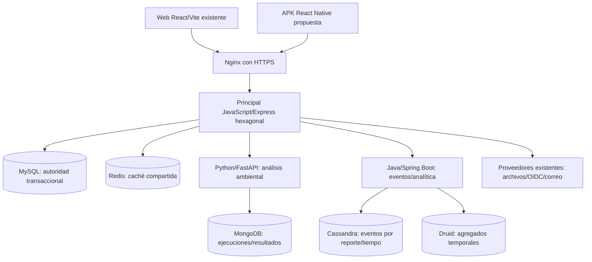

# Plan de cumplimiento del proyecto final

Fecha: **24 de noviembre de 2026, America/Bogota**. Base técnica: **9d966dd**. Fuente académica: Jacanamijoy (2026), siete páginas del [instructivo real](requisitos/Programación_avanzada-Instructivo_proyecto_final_2026-2.pdf). Diagnóstico y estados por requisito: [auditoría oficial](auditoria-cumplimiento-oficial.md). **Es una propuesta para revisión: no se implementa ni se inicia ninguna fase con esta entrega.**

## Viabilidad y fechas

**No es viable prometer el cumplimiento integral para el 25/11/2026 desde el estado comprobado de este checkout.** Faltan dos backends, cuatro motores funcionales, APK, jerarquía administrativa/MFA/doble OIDC, gran parte de la extracción del principal y entregables académicos. Ya existen una base reutilizable y 347 tests, pero crear contenedores, carpetas o documentación no resuelve esas faltas. No se conoce capacidad del equipo ni avances externos; deben inventariarse antes de estimar un calendario comprometido.

El instructivo fija **25/11: documentación/código en Moodle** y **02/12: sustentación**. No indica hora de cierre de Moodle: verificarla, sin asumir 23:59. El intervalo posterior no es autorización para entregar como completos requisitos aún ausentes el 25. Si el equipo no dispone de implementaciones adicionales verificables, corresponde acordar una ampliación o entregar un avance identificado como parcial, sin ocultar incumplimientos. Esta recomendación no envía mensajes ni solicita cambios al docente.

| Hito | Trabajo imprescindible | Condición de aceptación |
| --- | --- | --- |
| Corte del 24/11 | Revisar matriz, capacidad/avances externos y congelar contratos/base comprobada | Lista de responsables, brechas y decisión explícita sobre plazo/alcance. Sin iniciar una reescritura general. |
| Entrega del 25/11 | **Todos** los obligatorios: tres APIs, cinco motores, web/APK, seguridad, mecanismos medidos, infraestructura y documento/paquetes | Cumplir gates de fases siguientes. Si no se alcanzan, registrar NO CUMPLE/PARCIAL en versión entregada; no mover su definición a la sustentación. |
| 26/11–01/12 | Verificación, estabilización, recuperación de volúmenes, pruebas en teléfono/equipo limpio y ensayo | Corregir fallos de lo entregado. Implementaciones tardías solo con autorización de alcance/plazo; mantener diferencia con el SHA del 25. |
| Sustentación del 02/12 | Instalar APK, iniciar desde README, demostrar cada motor/servicio/rol y explicar aportes | Recorrido real, evidencias vinculadas a versión y capacidad de reproducir sin datos/servicios ajenos. |

No se asignan horas ficticias a tareas complejas. Se priorizan gates y dependencias; el equipo debe estimar cada fase con sus integrantes disponibles. Si se mantiene el cierre del 25, la ruta responsable inmediata es preservar lo funcional, preparar un paquete trazable y declarar las brechas, antes que introducir cinco tecnologías incompletas a última hora.

## Arquitectura final propuesta

Mantener **Express/JavaScript como principal**, React/Vite web y MySQL. El instructivo admite tecnologías equivalentes y no obliga a migrar a Java/NestJS/TypeScript. Añadir solo dos servicios con responsabilidades reales y tecnologías diferentes: **Python + FastAPI** para cálculo/análisis ambiental y **Java + Spring Boot** para eventos/analítica. Los servicios secundarios pueden usar MVC/estructura modular justificada; el principal debe completar dominio, aplicación, puertos y adaptadores.

**Figura 1. Propuesta de servicios y datos; no describe componentes ya implementados.** Fuente: elaboración propia sobre el código auditado y el mínimo de Jacanamijoy (2026).

Nginx ya existe; no se propone otro gateway, bus ni motor. No incorporar ML para aparentar complejidad: el algoritmo actual de cuadrícula/severidad/recencia es reutilizable. Si se eligiera ML posteriormente, aplicar su condición de servicio monolítico y algoritmo paralelo con medición. La concurrencia E/S no equivale a paralelismo CPU; FastAPI distingue ambos escenarios (FastAPI, s. f.). Spring permite ejecución administrada de tareas, pero se deben configurar límites/ciclo de vida y medir el proceso concreto, no dar por resuelto el requisito al añadir una anotación (Spring, s. f.).

| Componente | Alcance funcional limitado propuesto | Evidencia mínima para aceptarlo |
| --- | --- | --- |
| Principal Express | Identidad/autorización y operaciones transaccionales actuales, orquestación mediante puertos; conservar endpoints y DTO públicos | Dominio/casos sin imports de infraestructura; contratos existentes 33+38 y zonas sin regresión, más pruebas de operaciones migradas. Un wrapper que invoque el controlador heredado no basta. |
| FastAPI | Ejecutar cálculo ambiental por lote y guardar/consultar resultado versionado en MongoDB; consulta desde el principal usada por el flujo real de analítica | Entrada/salida definida, resultados contrastados con algoritmo actual, escritura/lectura Mongo, fallos/timeouts y uso desde web/APK. No solo /health. |
| Spring Boot | Aceptar eventos de reportes, persistirlos por reporte/tiempo en Cassandra, generar/consultar agregados Druid | Ingesta idempotente, consulta de historial/agregado desde el principal, errores/reintentos medidos, lectura/escritura y reinicio de ambos motores. |
| React/Vite | Conservar componentes y diseño; adaptar solo seguridad/consumo imprescindible y evidencia de tareas | Recorridos por roles, carga/error/éxito/vacío, teclado y regresión visual. |
| React Native | Cliente instalable real para autenticación y tareas propias de cada nivel | APK en teléfono, API accesible, almacenamiento seguro y evidencia del mismo caso web/móvil; no WebView que solo finja el requisito. |

No es necesario que cada backend escriba en los cinco motores. Cada motor sí necesita un consumidor y una función comprobable. Druid es un motor con varios componentes de ejecución; no se promete que baste un único contenedor. Su arquitectura incluye servicios de consulta, ingesta y almacenamiento que deben contemplarse en operación y consumo de recursos (Apache Software Foundation, s. f.). No agregar PostgreSQL/Kafka u otro motor por copiar un ejemplo: revisar si la versión elegida de Druid puede usar el MySQL existente como metastore **en base/usuario separados** y qué componentes de coordinación necesita. Validarlo antes de fijar topología; nunca usar la base del usuario para ensayar esa instalación.

## Propiedad de datos y contratos

| Dato | Fuente de verdad propuesta | Identificador, modelo y consulta | Consistencia y recuperación |
| --- | --- | --- | --- |
| Usuarios, roles/ámbito, sesiones y reportes/asignaciones/evidencias | MySQL | UUID externo conservando id numérico interno; FKs/UNIQUE y autorización del principal | Transacciones locales donde corresponda; respaldo/restore propio. Cloudinary conserva binarios, no sustituye un motor académico. |
| Ejecución analítica/versionada | MongoDB | run_id, algorithm_version, source_revision/hash, ventana, parámetros, zonas/resultados y estado; unicidad por clave de ejecución | Resultado derivado de instantánea validada de MySQL. No duplicar autoridad sobre estado del reporte. Recalcular y reconciliar con versión. |
| Eventos de reporte/atención | Cassandra | Partición propuesta (reporte_uuid, mes), clustering (occurred_at, event_id); consulta por reporte y rango | Registro de eventos aceptados, sin copiar contraseñas/tokens/PII innecesaria. event_id estable y límites de partición. Restaurar y reproducir proyección. |
| Indicadores ambientales | Druid | Tiempo por hora; dimensiones municipio/categoría/severidad; medidas definidas como eventos o reportes creados, nunca ambiguas | Proyección de eventos validados. Reingesta por intervalos y deduplicación/reemplazo comprobados para que replay no duplique agregados. Druid no aporta UNIQUE como MySQL. |
| Lecturas frecuentes | Redis | cache:zonas:vN:parámetros/ámbito; claves privadas con usuario/entidad. TTL de partida 300 s, sujeto a medición y justificación | Cache-aside, invalidación tras commit, fallback a origen, métricas hit/miss/latencia y prueba de caída. Caché nunca única autoridad. |

Redis puede mantener la caché mientras las sesiones siguen la estrategia JWT breve+refresh persistido en MySQL admitida por el instructivo. No es obligatorio duplicar sesiones en Redis. Si se decide hacerlo, usar prefijos session:/cache: y TTL separados. Cache-aside y TTL acotan obsolescencia, pero no sustituyen una política de invalidación/reconciliación (Redis, s. f.).

Contratos internos: versión de schema, event_id/run_id, reporte_uuid, occurred_at, source_revision, correlación y ámbito cuando corresponda; documentar payload, orden, timeout, cancelación, autenticación y errores. Los servicios no aceptan rol administrativo del body ni emiten privilegios por su cuenta. Definir verificación/introspección de credenciales con el principal y revocación efectiva antes de exponer las API internas. No compartir credenciales de usuario entre servicios ni abrir los motores al teléfono.

No hay atomicidad global entre cinco motores. Antes de implementar dual writes, decidir entrega durable y replay: una **outbox local en MySQL** puede justificarse si se necesita preservar eventos tras fallos; es una decisión/migración futura revisable, no una cola nueva ya autorizada ni una garantía actual. No añadir un broker adicional por conveniencia. Auditoría administrativa necesita igualmente autor, objeto, cambio y fecha durables; debe impedir borrado por los administradores que audita.

**Cambio de consistencia deliberado:** el alta existente usa autocommit+compensación lógica/remota. Agrupar SQL/auditoría/evento en una unidad de trabajo puede cambiar estados persistidos de fallo capturados en los 38 fixtures. Esa política requiere revisión explícita y pruebas nuevas; no se deben regenerar fixtures para ocultar el cambio. Una transacción SQL abierta durante subidas remotas no aporta atomicidad con Cloudinary. Mantener compatibilidad pública y hacer visibles las diferencias internas aprobadas.

## Fases acotadas y gates

Las fases siguientes representan trabajo **imprescindible para afirmar cumplimiento en la entrega**, aunque el calendario disponible no permita completarlo. No se trasladan silenciosamente a después del 25.

### F0 — Congelar contrato y plan del equipo

Alcance: inventariar avances externos si existen, confirmar integrantes/capacidad, crear catálogo RF/RNF/RN/CU y matriz de permisos/ámbitos, fijar contratos e identificadores antes de codificar. Base 9d966dd con fixtures intactos. Extraer del informe los ID P0 y asignar responsable/prueba/artefacto a cada uno.

Aceptación: diagrama objetivo, límites por servicio, fuente de verdad y contratos firmes; definición de los tres mecanismos elegidos y datos de prueba. Ningún motor se acepta por estar healthy.

Pruebas: repetir suites existentes; validar que dataset/usuarios sean sintéticos. Entregables: diseño/ADR, OpenAPI interna inicial y trazabilidad. Dependencias: ninguna técnica; requiere revisar esta auditoría. Relación: G02/G03/G08/G13/A12/A15/A16/DOC06–DOC11/DOC46.

### F1 — Identidad y autorización con riesgo acotado

Alcance: primero MFA administrativa y revocación efectiva ante logout/desactivación/cambio de privilegios; luego superadministrador/administrador de ámbito/usuario y auditoría durable. Registro público siempre común, inicializador controlado de primera cuenta global sin clave fija. Política de factor único >=15, soporte >=64 y rechazo de comunes/comprometidas coherente en registro/cambio/reset. Conservar hashes scrypt válidos; hash asíncrono y actualización de costo/versionado se diseñan sin invalidación masiva.

Completar dos OIDC reales: reutilizar Google y añadir un proveedor OIDC como Microsoft; Facebook OAuth no se presenta como segundo OIDC. Exigir validación de identidad y consentimiento, callbacks seguros y rol local; OIDC añade identidad sobre OAuth, no basta el access token (OpenID Foundation, s. f.). Configuración de aplicaciones/credenciales/callbacks es una dependencia externa con responsable del equipo.

Conservar JWT breve+refresh con rotación; agregar límite por inactividad y máximo absoluto de familia, fijados por política documentada (el PDF no prescribe sus minutos). Web con HTTPS/cookies Secure/HttpOnly/SameSite y CSRF al activar cookies; móvil con almacenamiento seguro. La compatibilidad Bearer de clientes/API se revisa al migrar transporte, sin rediseñar pantallas. No copiar localStorage a React Native; tratar secretos de app y almacenamiento sensible según plataforma (Meta Platforms, Inc., s. f.).

Aceptación: un JWT retirado/de usuario desactivado no accede a API admin; admin sin segundo factor no obtiene privilegios; segundo nivel no se eleva ni cruza ámbito; ningún nivel borra auditoría. Logout UI llama al servidor y revoca la sesión. Dos proveedores probados de extremo a extremo, sin secretos en capturas.

Pruebas: reenviar tokens revocados; cambio de rol durante sesión; MFA incorrecto/ausente/recovery; intentos limitados; carrera de refresh; recuperación/rotación/límites de sesión; contraseñas 14/15/64/common; CSRF y cookies; permisos objeto×rol×ámbito en cada API. Entregables: módulo/puertos de identidad, migraciones controladas, pruebas y matriz. Dependencias: F0 y configuración OIDC/TLS; extraer identidad como módulo limitado antes de conectar servicios nuevos. Relación: S02–S38.

### F2 — Dos servicios y un recorrido vertical real

Alcance: crear FastAPI y Spring Boot con health, errores, autenticación interna y contratos. Una sola operación ambiental del FastAPI y una de historial/indicador del Spring al principio, consumidas desde el principal. No duplicar CRUD de reportes, contraseñas, catálogo o permisos en cada backend. No migrar Express a otro lenguaje.

Aceptación: web → principal → cada servicio → su persistencia → respuesta útil; denegación sin credenciales/ámbito, timeout y caída controlada. Cada servicio tiene estructura justificada y concurrencia pertinente con creación/límite/cierre de tareas. No aceptar APIs desconectadas del producto.

Pruebas: contratos DTO/versiones/errores, solicitudes simultáneas, servicio caído, timeout/cancelación, salida determinista y caso negativo de autorización. Entregables: fuentes/manifests/locks/Dockerfiles/OpenAPI/tests, conectores del principal mediante puertos. Dependencias: F0, contrato de F1 y primer motor de F3; interfaces permiten trabajo paralelo sin afirmar integración prematura. Relación: G02/G04/A07/A08/A12/A14/A19.

### F3 — Cinco motores, consistencia y restauración

Alcance por incremento: MySQL estable → Redis cache-aside → Mongo con una ejecución/consulta → Cassandra con un evento/historial → Druid con una ingesta/agregado. Diseñar particiones/índices/volúmenes antes de cargar. Ni Mongo ni Cassandra almacenan de nuevo el reporte transaccional completo como autoridad rival.

Aceptación de cada motor: servicio consumidor identificable, modelo/diccionario, escritura/lectura con resultado visible, referencia UUID correcta, persistencia al reiniciar, datos ficticios reproducibles y prueba de fallo/replay. Para Druid, verificar igualdad de agregados contra la fuente y que dos ingestas del mismo lote no dupliquen métricas. Para Redis, demostrar hit/miss/TTL/invalidation/latencia/aislamiento/fallback. Recuperar backups en volúmenes nuevos dentro de proyecto de pruebas.

Pruebas: reinicio, caída/reintento, duplicado simultáneo, versión atrasada, idempotencia y reconciliación; nunca apuntar estos scripts a volúmenes existentes. Entregables: compose.datos.yml, inicializadores, modelos, fixtures, pruebas y manual backup/restore. Dependencias: F0, servicios consumidores F2 y política de evento/consistencia acordada. Relación: G08–G12/A15/D01–D42/I01/I19.

### F4 — Completar principal hexagonal por módulos

Alcance: conservar las tres extracciones y retirar progresivamente dependencia de controladores/modelos concretos en identidad, gestión de reportes, categorías/usuarios, instituciones/notificaciones y consultas analíticas/exportación/chatbot. Una operación o módulo acotado por cambio; dominio/aplicación sin Express/mysql2/process.env. Los puentes de compatibilidad se retiran solo al migrar sus consumidores.

Aceptación: diagrama y ubicación de cada responsabilidad del principal, puertos implementados/composición explícita y tests sin infraestructura. No crear clases vacías ni un contenedor DI por apariencia. Todas las rutas, permisos, errores, orden/coordenadas y funcionalidades originales preservadas salvo cambios de seguridad/consistencia explícitamente revisados.

Pruebas: fixtures previos, contrato de cada nueva extracción y regresión total 347+33+38+57+8 más nuevos casos; revisar alcance real y no exigir que todo pase solo con dobles. Entregables: módulos migrados con documentación y pruebas por cambio. Dependencias: F0, decisiones F1/F3; puede avanzar por módulos con propietarios separados, pero no todos editando reporte.controller.js/modelos al mismo tiempo. Relación: G03/A01–A05.

### F5 — Móvil y experiencia compartida

Alcance: cliente React Native sin reconstruir diseño web. Primer recorrido: acceso → listado → detalle → crear reporte → verificar persistencia; luego una tarea completa por los otros dos niveles, con permisos de API efectivos. Incluir evidencia/ubicación donde el flujo la use; no limitar el APK a una pantalla de login.

Aceptación: APK instalada en un teléfono, API real alcanzable, reanudación/expiración de sesión segura, carga/error/éxito/vacío, prevención de doble envío y regreso coherente. Misma marca/tokens, adaptación a targets táctiles y permisos. Comparación de la misma tarea y datos en web/móvil.

Pruebas: dispositivo físico, red lenta/interrumpida, URLs/API de rol superior, límites de archivos, coordenadas, sesión revocada y tareas por rol. Web: teclado/foco, contraste, labels y mensajes anunciables. Entregables: fuentes/manifests/lock, APK asociada a SHA, guía visual y capturas reales con título/número/fuente. Dependencias: F0, contratos estables, F1/TLS; se puede iniciar con dobles de contrato, pero la aceptación exige servidor real. Relación: G06/G07/S21/U01–U23.

### F6 — Docker reproducible y pruebas de tres mecanismos

Alcance: compose.datos.yml y compose.apps.yml con una red externa documentada; nombres de servicio, volúmenes y health/readiness reales; Dockerfile/ignore/env.example por servicio. Backend no-root; fijar tags/digests y runtimes de los nuevos servicios. Mantener override aislado de pruebas y órdenes seguros. Compilación multietapa donde aporte (web/Java), no exigirla artificialmente al JS sin compilación.

Mecanismos candidatos de alcance limitado:

1. **E/S concurrente acotada:** lecturas/contexto existentes del principal, y consultas independientes/lotes de los otros servicios, con límites, timeout y cancelación. Medir secuencial/concurrente con el mismo dataset y respuestas iguales en cada backend.
2. **Caché Redis cache-aside:** lecturas frecuentes, TTL justificado/invalidation, caída/fallback, aislamiento y métricas hit/miss/latencia; comparar frío/caliente/origen. Su uso real no es un CRUD adicional.
3. **Integridad e idempotencia bajo concurrencia:** rotación refresh/transacción y entrega/replay de un evento; duplicado simultáneo sin repetir efectos, consistencia comprobada y medición del proceso.

El algoritmo ambiental aporta otra evidencia de programación avanzada. Solo usar workers/procesos para él si el perfil revela CPU pesada y se observa beneficio; si se activa esa carga, comparar secuencial/paralelo con resultados reproducibles y CPU/RAM. No usar esperas artificiales ni quemar CPU sin utilidad para aparentar paralelismo. La sonda de 20 lecturas vacías de la auditoría es exploratoria y no cumple ese benchmark final.

Aceptación: tres mecanismos identificados con utilidad/código/prueba/medición, y concurrencia pertinente en **cada backend**, no solo tres mecanismos en uno. Repetir muestras, anotar dataset/equipo/concurrencia/latencias/errores/recursos. Arranque completo desde instrucciones, reinicio y restore sin depender de contenedores ajenos.

Entregables: Compose, imágenes/locks, scripts de pruebas, tablas de métricas y fallos/limitaciones. Dependencias: F1–F5 integradas por contratos; diseño de infraestructura puede comenzar en paralelo. Relación: G13/A06–A09/D29–D42/I01–I20.

### F7 — Informe, paquete y evidencia de versión

Alcance: redactar los once componentes, RF/RNF/RN/CU y matriz requisito→caso→API→prueba→evidencia. Diagramas fuente de contexto/servicios/componentes/despliegue, diccionario por motor y API completa. OpenAPI actual cubre 78 métodos/rutas: completar schemas/IA/JSON/skip_view/errores y añadir las dos API, sin regenerar contratos desde suposiciones.

Aceptación: PDF y editable coherentes, figuras/capturas con número/título/fuente, APA 7 autor/año y bibliografía completa bidireccional; manual por rol, instalación, variables, semillas, limitaciones, recuperación y demostración. No rellenar secciones con características planeadas como si funcionaran.

Pruebas/entregables: reconstruir desde checkout limpio; ejecutar suites y guardar resultados con SHA; instalar APK de esa versión; preparar ZIP sin node_modules/secretos/datos personales; archivo con URL y SHA/tag; PDF/editable/APK o enlace a artefacto y tabla de aportes individuales verificables. Confirmar que Moodle y GitHub sean la misma versión. La publicación/subida requiere una tarea/autorización posterior; **no se hace push ni subida en esta auditoría**.

Dependencias: redacción puede comenzar desde F0; el cierre depende de las evidencias reales F1–F6. No declarar finalizados DOC/ENT porque existan dos documentos de auditoría. Relación: DOC01–DOC50/ENT01–ENT17.

## Paralelismo del equipo y ruta crítica

Los frentes son unidades de trabajo sugeridas, no asignaciones a integrantes desconocidos ni subagentes ejecutados en esta auditoría.

| Frente independiente tras F0 | Puede avanzar en paralelo | Bloqueo antes de integrar |
| --- | --- | --- |
| Identidad/principal | MFA, sesiones, jerarquía/auditoría y extracción de un módulo | Define tokens/permisos que usarán móvil y servicios; no cambiar contratos a espaldas de otros frentes. |
| Servicio Python/Mongo | Modelo de ejecuciones, contrato y análisis versionado con datos sintéticos | UUID/versiones/entrada estable; comparación con algoritmo actual antes de sustituirlo. |
| Servicio Java/Cassandra/Druid | Modelo de evento, particiones, ingesta/proyección y pruebas | Contrato/autorización de evento y consistencia; Druid requiere recursos y topología verificadas. |
| Cliente móvil/marca | Navegación/pantallas nativas y adaptadores de red/almacenamiento con dobles | APK final depende de HTTPS/identidad/servidores reales; mocks no acreditan el recorrido. |
| Infra/QA/documentación | Dos Compose, aisladores, esquemas del informe, trazabilidad y planes de prueba | No escribir resultados esperados como observados; cierre depende de servicios/APK funcionando. |

Ruta crítica: **F0 → identidad/contratos y modelo de evento → integración útil de servicios/motores → recorridos web/APK y principal hexagonal → mediciones/restore/reconstrucción → paquete/versión/Moodle → ensayo**. FastAPI/Mongo y Java/Cassandra/Druid pueden construirse en paralelo entre sí después de acordar contrato. La red Compose y el esquema del documento también. Cambios compartidos en rutas/modelos/controladores y contratos de autenticación se integran de forma secuencial con dueño claro y pruebas; no atribuir velocidad a ediciones concurrentes del mismo archivo.

## Riesgos y criterios de interrupción

| Riesgo | Impacto | Control/gate |
| --- | --- | --- |
| Plazo insuficiente | Entregar fachada de cumplimiento | Declarar brechas al corte, revisar capacidad y solicitar decisión de alcance/plazo. No ocultar incumplimientos con un porcentaje. |
| Credenciales OIDC/TLS/teléfono no disponibles | Bloquea identidad/APK real | Responsable y configuración en F0; pruebas con dobles etiquetadas, nunca sustituyen el proveedor/dispositivo. |
| Sobrecarga Druid+Cassandra+Java y varios procesos | Caídas/latencia/arranque no reproducible | Presupuesto de CPU/RAM/disco medido en equipo de demostración, perfiles de prueba; no dar por suficiente un pull. |
| Dual writes/eventos duplicados o perdidos | Métricas erróneas, historial inconsistente | Autoridad única, event_id/revision, entrega durable acordada, replay/reconciliación y pruebas de caída. |
| Cambiar política transaccional del alta | Romper fixtures/errores/compensación | Decisión funcional separada; mantener comparación histórica y pruebas nuevas explícitas. |
| Extraer todo el principal de golpe | Pérdida de funcionalidades | Cambios acotados por módulo, puentes, integración continua local y reversión sin borrado de datos. |
| Portar web directamente a móvil | APK incompleta/insegura | Reutilizar reglas/assets, adaptar DOM/Leaflet/archivos/storage/baseURL; validar dispositivo. |
| Roles/caché con JWT obsoleto | Acceso administrativo o datos cruzados | Introspección/versión de sesión, scope/tenant en claves, negativas por API/objeto y revocación real. |
| Cambiar ejes/fechas/orden al mover cálculo | Resultados ambientales distintos | Fixtures vigentes, fechas UTC controladas, longitud/latitud y tolerancia numérica donde aplique, sin normalizar diferencias del contrato. |
| Documentar características no probadas | Incumplimiento oculto en sustentación | Evidencia con SHA/dataset/comando, separar real/doble/pendiente y citar fuentes de figuras. |
| Copiar secretos o publicar versión distinta | Exposición y entrega no trazable | Secret scan de release/historia según alcance; paquetes desde lista permitida, hashes y comprobante de entrega. |

Si un gate falla, se detiene esa integración y se preserva la versión funcional anterior; no se elimina un endpoint, prueba o validación para obtener verde. La autorización de esta auditoría no habilita ejecutar estas fases.

## Estabilización y sustentación: 26/11–02/12

Si se completaron los obligatorios el 25, o se acordó una ampliación explícita, reservar el periodo para:

- **26–27/11:** instalación desde cero y restore sobre volúmenes nuevos; replay/eventos, expiración y pérdida de permisos; revisar consumo de recursos.
- **28–29/11:** flujos web/móvil por los tres niveles en dispositivo, carga/error/éxito/vacío, accesibilidad, casos negativos de API/objeto y fallos de cada motor/servicio.
- **30/11–01/12:** repetir mediciones y regresión, congelar SHA/APK/informe, comprobar versiones/artefactos, ensayar explicación individual y alternativa sin conectividad a proveedores.
- **02/12:** iniciar desde README, mostrar operaciones reales en cada motor, comunicaciones, tres mecanismos y al menos diez tests, y explicar aportes. Reconocer límites restantes con evidencia.

No presentar un fallback offline como prueba de que un proveedor remoto funcionó. No presentar una imagen Docker ajena como uso de Cassandra/Druid/Redis. No modificar entregas publicadas sin registrar una nueva versión y la autorización correspondiente.

## Referencias

Apache Software Foundation. (s. f.). *Architecture*. Apache Druid. https://druid.apache.org/docs/latest/design/architecture/

FastAPI. (s. f.). *Concurrency and async / await*. https://fastapi.tiangolo.com/async/

Jacanamijoy, F. (2026). *Instructivo del proyecto final de Programación Avanzada* [Instructivo de curso, 7 páginas]. Institución Universitaria Putumayo. [Documento local](requisitos/Programación_avanzada-Instructivo_proyecto_final_2026-2.pdf).

Meta Platforms, Inc. (s. f.). *Security*. React Native. https://reactnative.dev/docs/security

OpenID Foundation. (s. f.). *How OpenID Connect works*. https://openid.net/developers/how-connect-works/

Redis. (s. f.). *Redis cache-aside*. https://redis.io/docs/latest/develop/use-cases/cache-aside/

Spring. (s. f.). *Task execution and scheduling*. Spring Boot. https://docs.spring.io/spring-boot/reference/features/task-execution-and-scheduling.html

Fuentes técnicas primarias consultadas el 24/11/2026; no se fijan versiones nuevas sin probarlas en una fase autorizada. Este plan no sustituye el formato APA 7 con sangría francesa y revisión editorial del PDF/editable final.
